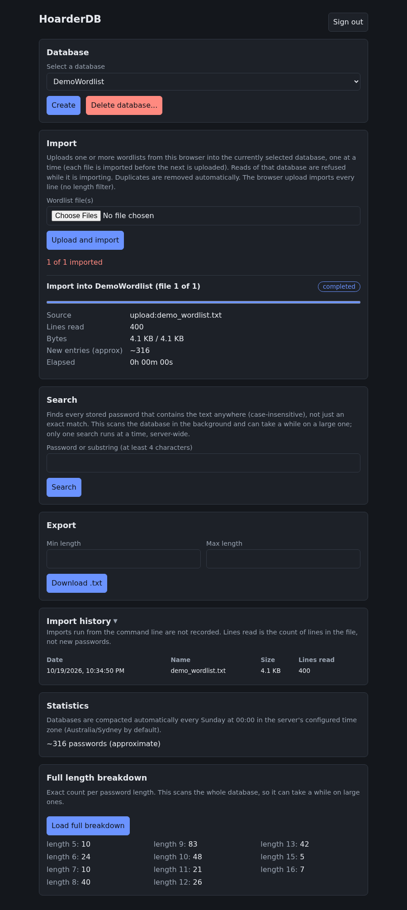

# HoarderDB

HoarderDB is a command-line tool for importing wordlists into a database and exporting new wordlists that match specific requirements, most commonly by password length. It is designed for security testing and password research, where wordlists are often very large (hundreds of gigabytes) and need to be merged, deduplicated, and filtered quickly. Passwords are stored in an embedded database, so there is no server to run and the database is a single portable directory.



## Features

- **Import** - Add one or more wordlists in a single command, from files, directories, or wildcard patterns. Duplicates within a file, between files, and against data already stored are removed automatically.
- **Export by length** - Produce a new wordlist containing every password of an exact length, or within a length range such as 8 to 12 characters.
- **Exact lookup** - Check whether a specific password already exists in the database, with script-friendly exit codes.
- **Substring search** (web UI/API) - Find every stored password that contains a given string anywhere, not just an exact match; runs as a background scan on large databases without blocking imports or compaction.
- **Web UI** - An optional login-protected browser interface for creating/deleting databases, importing, exporting, searching and viewing stats, plus a per-database import history with SHA-256 duplicate detection.
- **Built for scale** - Tuned for fast, sustained imports of very large wordlists using an embedded RocksDB store with universal compaction, a bulk-load memtable, and a multi-threaded write pipeline.

## Getting Started

### Prerequisites

- [.NET SDK 9.0 or later](https://dotnet.microsoft.com/download)

### Installation

1. Clone the repository:
   ```
   git clone https://github.com/ChrisLPJones/HoarderDB.git
   ```
2. Navigate to the project directory:
   ```
   cd HoarderDB
   ```
3. Build the solution:
   ```
   dotnet build -c Release
   ```
   The CLI is built from `src/HoarderDB.Cli`; run it with `dotnet run --project src/HoarderDB.Cli -- <command>` or use the built `hoarderdb` executable under `src/HoarderDB.Cli/bin/Release/net9.0/`.

To run the engine tests:
```
dotnet test
```

To produce a single self-contained executable that requires no .NET installation on the target machine, run the included script. The finished `hoarderdb.exe` is written to the `dist` folder:
```
.\build-exe.ps1
```

### Usage

Import one or more wordlists into a database. Arguments may be files, a directory, or a wildcard pattern, and `--recursive` descends into subdirectories:
```
hoarderdb import rockyou.txt --db MyWordlist
hoarderdb import a.txt b.txt c.txt --db MyWordlist
hoarderdb import "C:\Wordlists\WPA" --recursive --db MyWordlist
```

Export a new wordlist by length:
```
hoarderdb export out.txt --db MyWordlist --min 8 --max 12
hoarderdb export len8.txt --db MyWordlist --length 8
```

Look up an exact password (exit code 0 if found, 2 if not):
```
hoarderdb lookup "P@ssw0rd123" --db MyWordlist
```

Show statistics, count matches, or optimize the database for reading:
```
hoarderdb stats --db MyWordlist
hoarderdb count --db MyWordlist --min 8 --max 12
hoarderdb compact --db MyWordlist
```

Generate the password hash the web app needs (the password is read from stdin, never from the command line; it prompts with hidden input on a terminal):
```
hoarderdb hashpw
```

Run `hoarderdb --help` for the full list of commands and options.

## Web app

`src/HoarderDB.Web` serves the same engine over HTTP: a small login-protected UI plus a JSON API for stats, count, lookup, a "contains" substring search, streamed export, and background import / compact / search jobs with live progress. It is meant to sit behind a TLS-terminating reverse proxy (e.g. Caddy) on the same host; Kestrel binds `http://127.0.0.1:5080` by default and trusts `X-Forwarded-*` from loopback only. Session cookies are HttpOnly, Secure and SameSite=Strict, so the UI must be reached over HTTPS.

RocksDB allows only one process per database directory, so the web app must be the only process holding a database open: do not run the CLI against a database while the web app is serving it.

Configuration is read from `appsettings.json` and environment variables (use `__` for nesting). Two prefixes are recognised: `HOARDERDB_` (current, recommended for new configuration) and `CRACKDB_` (pre-rebrand; still honored so an existing deployment's env file keeps working unchanged). Both may be set for the same variable - `HOARDERDB_` wins if they disagree. There are no defaults for paths or credentials; the app refuses to start if a required one is missing.

| Variable (`HOARDERDB_` recommended; `CRACKDB_` also still works) | Required | Meaning |
|---|---|---|
| `Storage__DataRoot` | yes | Existing directory whose subdirectories are the databases. |
| `Storage__KeyPath` | yes | Directory for the Data Protection key ring (keep it private, mode 0700) so sessions survive restarts. |
| `Storage__IncomingRoot` | no | Existing directory that server-side imports are read from (e.g. `/data/incoming`); browser uploads are staged in its `.uploads` subfolder. Unset disables file import and upload (compact still works). |
| `Compaction__TimeZone` | no | IANA time zone for the weekly auto-compaction (Sunday 00:00 local time), default `Australia/Sydney`; `UTC` also works. DST-aware. An unknown id aborts startup; the host needs the `tzdata` package (`/usr/share/zoneinfo`) for any zone other than `UTC`. |
| `Upload__MaxBytes` | no | Cap for a browser upload in bytes. Unset or `0` (the default) means no limit; the file is streamed to disk and the upload is refused with 507 if free disk space runs low. A reverse proxy in front may impose its own body-size limit. |
| `Auth__Username` | yes | Login user name. |
| `Auth__PasswordHash` | yes | Output of `hoarderdb hashpw`. |
| `Auth__ApiKeyHash` | no | Lowercase hex SHA-256 of the API key; unset disables API-key access. |
| `Auth__LoginAttemptsPerMinute` | no | Login attempts per client IP per minute (default 5). |
| `Auth__PasswordChangeAttemptsPerMinute` | no | Password-change attempts per client IP per minute (default 5). Separately, 5 wrong current-password attempts lock the change for 15 minutes (in memory). |
| `ForwardedProxies` | no | Comma/space-separated IP addresses of reverse proxies (other than loopback) trusted to send `X-Forwarded-For`/`-Proto`, e.g. your Caddy host. Default: loopback only. Invalid values abort startup. |
| `ForwardedNetworks` | no | Same, as CIDRs (e.g. `192.168.50.0/24`). Only list networks where nothing but your proxy can reach the app port. |

For example, the data root is `HOARDERDB_Storage__DataRoot` (or the still-supported `CRACKDB_Storage__DataRoot`).

**Changing the password:** signed-in users change it on the Settings page (`/settings.html`); it needs the current password and a new one of 12-128 characters. The new hash is stored in `<KeyPath>/admin-password.json` (mode 0600, hash only) and takes precedence over `Auth__PasswordHash` while that env value is unchanged, so it survives restarts and redeploys. All other sessions are signed out; the API key is not affected. Recovery if the password is lost: set a new `Auth__PasswordHash` (`hoarderdb hashpw`) and restart (a changed env hash overrides the stored one), or delete `admin-password.json` to fall back to the env hash. A present but unreadable `admin-password.json` (including a dangling link) aborts startup (fix or delete it).

Make an API key and its hash (keep the key itself out of config files; only the hash goes in the environment):
```
KEY=$(openssl rand -hex 32); echo "$KEY"; printf '%s' "$KEY" | sha256sum | cut -d' ' -f1
```

Run it (put the variables in a mode-0600 environment file for a service):
```
dotnet run --project src/HoarderDB.Web -c Release
```

Endpoints (all but `/healthz` need the session cookie or an `X-API-Key` header; errors are RFC 7807 problem JSON):

- `GET /healthz` - `ok`.
- `POST /api/account/password` - JSON `{ "currentPassword", "newPassword" }`; session cookie only (an API key gets 403). 204 on success (this browser stays signed in), 403 wrong current password, 400 rule violation or bad body, 415 not JSON, 429 rate limited or locked out, 500 could not save.
- `GET /api/dbs` - database names.
- `POST /api/dbs` - JSON `{ "name" }` creates a new, empty database. Returns 201 `{ "name" }`; 400 for an invalid name, 409 if it already exists or the database limit (512) is reached.
- `DELETE /api/dbs/{name}` - permanently deletes the database directory. 204 on success; 404 if it does not exist (including a repeat delete); 400 for an invalid name; 409 if an import/compact job is queued or running for it.
- `GET /api/dbs/{name}/stats[?full=true]` - approximate total; `full` adds an exact per-length breakdown (full scan).
- `GET /api/dbs/{name}/count[?min=&max=&length=]` - approximate total, or an exact count when a bound is given.
- `GET /api/dbs/{name}/lookup?word=...` - exact membership. The word is in the URL, so it can appear in proxy access logs.
- `POST /api/dbs/{name}/search` - JSON `{ "query", "min"?, "max"?, "cap"? }`: exact membership is answered inline (`exactFound`, same point read as `/lookup`); a case-insensitive **substring** match ("contains the text anywhere") then runs as its own background job, tracked through the job routes below. `query` must be at least 4 characters (400 otherwise, enforced server-side); length-narrowing is automatic (never scans entries shorter than `query`, in addition to any `min`/`max` you pass). `cap` defaults to 500 and is clamped to 2000 (never user-raisable past that). Only one search runs at a time, server-wide, independent of import/compact (409 `"Search is busy."` for a second concurrent one) and rate-limited per IP. Returns 202 `{ "id", "exactFound", "query", "cap" }`. The job's snapshot (`GET /api/jobs/{id}`, SSE, cancel - all the same routes as import/compact) adds `scannedCount`, `matchedCount`, `matches` (capped to `cap`) and `capped`. A search never holds the database open for its whole scan: it releases and re-acquires its read lease every chunk, so it only ever contends with that database's own next import/compact window (briefly, like any other read) and never blocks - or is blocked by - a job on a different database. There is no persistent search index; this is a full scan, bounded by the length-narrowing, the cap, and the minimum query length.
- `GET /api/dbs/{name}/imports[?limit=&offset=]` - the database's import history, newest first: `{ "total", "entries": [...] }` (limit default 50, max 5000, the per-database cap on stored entries, so one request can return everything). Each entry has the date, source label, SHA-256 of the file bytes, size, status (`completed`, `cancelled`, `failed`, `backfilled`), length filter, lines read and whether a duplicate warning was overridden. Works while an import is running. Imports run with the `hoarderdb` command line are not recorded, and databases that existed before this feature start with an empty history (see `imports/backfill` below to record them after the fact).
- `POST /api/dbs/{name}/imports/check` - JSON `{ "sha256"? , "name"?, "size"?, "min"?, "max"? }`: is this content already imported? With `sha256` (64 hex characters, e.g. from `sha256sum`) the answer is authoritative; with only `name` and `size` it is an advisory hint. Returns `{ "advisory", "duplicate", "changed", "note" }`. A `backfilled` record counts exactly like a `completed` one here.
- `POST /api/dbs/{name}/imports/backfill` - records files already imported outside the app (e.g. before this feature existed, or by a script), without reading or re-importing them: JSON array of `{ "name", "sha256", "sizeBytes", "importedAtUtc" }` (the caller hashes the file itself; `sha256` must be 64 hex characters). `name` is a display label only - any path is stripped to the base name, defensively, even though it is expected to come from your own script, not a browser. Each entry is stored as status `backfilled` with no length filter (unbounded), so a later real import with a narrower filter is still seen as already-done. An entry whose hash already has a `completed` or `backfilled` record (including an earlier entry in the same batch) is skipped, not duplicated, and reported under `skipped`, not as an error. The whole batch is rejected 400 if any entry is invalid (naming the failing index) and 413 if it would push the database's history past the 5000-entry cap (rejected whole, never truncated). Returns `{ "written", "skipped": [{ "sha256", "reason" }], "total" }`.
- `POST /api/dbs/{name}/export` - streamed download ordered by length then password; JSON body or form fields `min`, `max`, `length`, `limit`, `filename`. `filename` is optional and untrusted: it is rebuilt server-side from an allowlist (letters, digits, `. _ - space`; anything else becomes `_`), only the last path segment is kept, the stem is capped at 100 characters, a trailing `.txt`/`.lst` is dropped and `.lst` appended, and Windows device names get a `_` prefix. Absent = the legacy `<db>_<range>_<timestamp>.txt` name; present but empty (or nothing usable left) = `wordlist.lst`. Non-ASCII names get an ASCII fallback plus an RFC 5987 `filename*`. The web UI always sends it (default `wordlist.lst`, `wordlist-<min>-<max>.lst`, `wordlist-min<N>.lst` or `wordlist-max<N>.lst`).

Import and compact run as background jobs, one at a time (a bulk import uses several GB of RAM), and jobs are kept in memory only: they are lost on restart, but a re-run is safe because import dedups. Large lists should be copied into `IncomingRoot` and imported by path; the file is streamed, never loaded whole. While a database is importing or compacting, reads of that database return 409 with a plain-language message naming the running job (other databases are unaffected); the UI shows a maintenance banner and says when a queued job is waiting behind another. Job routes (same auth as above; errors are problem JSON):

- `POST /api/jobs/import` - JSON `{ "db", "source", "min"?, "max"? }`. `source` is a path relative to `IncomingRoot` (no `..`, absolute paths, dot-prefixed names or symlinks); `db` is created if it does not exist. Optional `"force": true` imports even if identical content was already imported. Returns 202 `{ "id" }`. The job hashes the file first (one extra sequential read); if the same content (SHA-256) was already imported completely with a length filter that covers this one, the job ends as `cancelled` with the error `Skipped: identical content already imported on <date>` and a `duplicateOf` field, and nothing is imported.
- `POST /api/jobs/upload` - `multipart/form-data` with the fields `db`, optional `min`/`max`, then the `file` part last. The web UI accepts several files and sends them one POST at a time (each import finishes before the next upload), showing upload progress. Streamed to a temporary file and deleted when the job ends; over the cap (when `Upload:MaxBytes` is set) is 413, low free disk space is 507, and only one upload runs at a time (a second gets 409). Lines longer than 8 KiB are skipped and counted in the job's `errors`. Optional field `force=true` (before the file part) imports even if identical content was already imported; otherwise a duplicate upload is answered 409 with `"code": "already_imported"` and `duplicateOf` (409 is also used for "another upload in progress", so branch on `code`). The 202 body is `{ "id", "note"?, "previous"? }`; `note` flags a changed file (same name, different content) or a wider length filter than before.
- `POST /api/jobs/compact` - JSON `{ "db" }`; the database must exist (404 otherwise). A running compaction cannot be cancelled. Every database is also compacted automatically each Sunday at 00:00 in the configured time zone (`HOARDERDB_Compaction__TimeZone` / `CRACKDB_Compaction__TimeZone`, default Australia/Sydney) through the same job queue (no catch-up if the server was down at that time).
- `GET /api/jobs` - recent and active jobs; `GET /api/jobs/{id}` - one job (poll this from scripts).
- `GET /api/jobs/{id}/events` - Server-Sent Events progress snapshots, ending after the final one. Session cookie only (`EventSource` cannot send `X-API-Key`).
- `POST /api/jobs/{id}/cancel` - stops an import after the current line (data already read is kept and flushed) or removes a queued job.

Import reports lines read and an approximate count of new entries (before/after estimate), not exact duplicates.

Import history is a small JSON file (`hoarderdb-import-history.json`) inside each database directory, so it is deleted with the database and moves with it (include it when copying or backing up a database; it is advisory only). It keeps the latest 5000 imports per database. "Already imported" means the same SHA-256 of the raw file bytes was completed earlier with a length filter that covers the new one; cancelled and failed imports never count, and the same file name with different content is treated as a new import.

Database names must match `[A-Za-z0-9][A-Za-z0-9._-]{0,63}` and be a RocksDB directory directly under `DataRoot`; anything else is 400 or 404.

## Example

```
> hoarderdb import rockyou.txt breachlist.txt --db MyWordlist
Importing 2 file(s), 0.53 GB total -> MyWordlist
  lines read      : 58,144,214
  ~new entries    : 51,320,908   (approx; duplicates auto-collapsed)
  ~total in db    : 51,320,908   (approx)
  elapsed         : 6.2s   (9,378,102 lines/s)

> hoarderdb export wpa_8to12.txt --db MyWordlist --min 8 --max 12
Exported -> 'wpa_8to12.txt'
  criteria   : length 8..12
  written    : 24,908,551 passwords
  elapsed    : 3.1s

> hoarderdb lookup "hunter2" --db MyWordlist
FOUND    : 'hunter2' is in the database.
```

## Project Structure

- `HoarderDB.sln` - Solution containing all projects below.
- `src/HoarderDB.Core/` - Class library with the storage engine (`WordlistDatabase.cs`) covering import, export, lookup, and compaction.
- `src/HoarderDB.Cli/` - The `hoarderdb` command-line tool: `Program.cs` (command handling) and `Progress.cs` (live progress bars).
- `src/HoarderDB.Web/` - ASP.NET Core web host: read-only API, single-user auth and a static UI (see "Web app" above).
- `tests/HoarderDB.Core.Tests/` - xUnit tests for the engine; they only use throwaway `Test_`-prefixed temp databases.
- `tests/HoarderDB.Web.Tests/` - xUnit tests for the web app (`WebApplicationFactory`, throwaway `Test_` data roots).
- `build-exe.ps1` - Builds a single self-contained executable of the CLI.

## How It Works

HoarderDB stores each password in an embedded RocksDB key-value store under a key of the form `[length][password]`. Because the key begins with the length, all data is physically ordered by length, which makes the supported queries efficient:

1. An exact lookup is a single point read.
2. A single length, or a length range, is one contiguous scan.

Deduplication is automatic. Identical passwords produce identical keys and collapse, both within a single import and against everything already stored.

The import path is tuned for very large wordlists:

- **Universal compaction** rewrites data far less than the default configuration, so a large import does not slow down as the database grows.
- A **bulk-load memtable** and a **multi-threaded, allocation-free write pipeline** keep throughput high.
- Compaction is deferred during import for maximum speed. Run `hoarderdb compact` afterwards to consolidate the database for fast reads.

Disk space is traded for speed, so a database is larger than the source wordlists. For best performance, keep the source files and the database on a fast local NVMe drive.

## Intended Use

HoarderDB is intended for authorized security testing, password-strength research, CTF challenges, and managing your own wordlists. Only use it against systems you own or are explicitly authorized to test.

## Contributing

Contributions are welcome. Feel free to fork the repository and submit a pull request.

## License

This project is licensed under the MIT License. See the LICENSE file for details.
